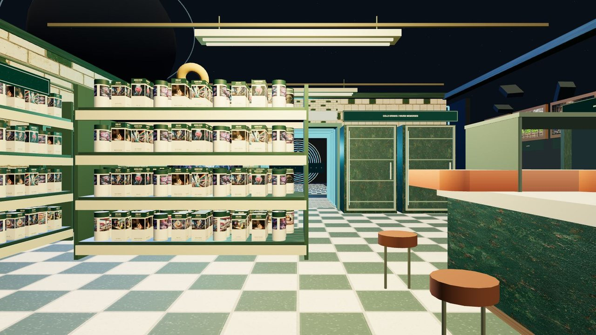
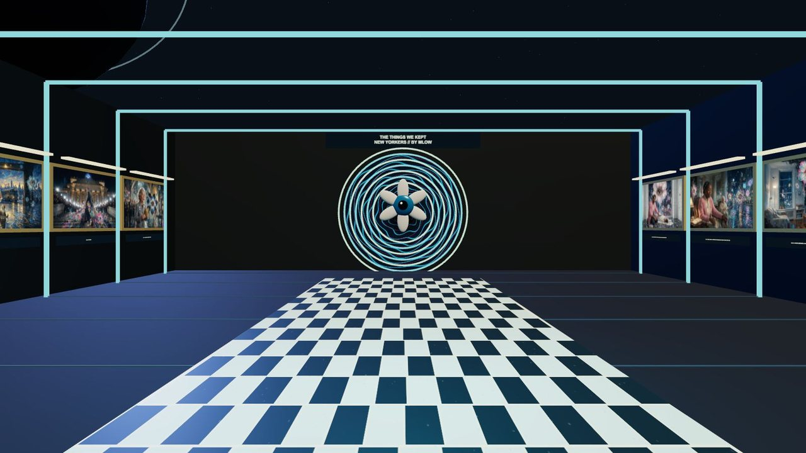
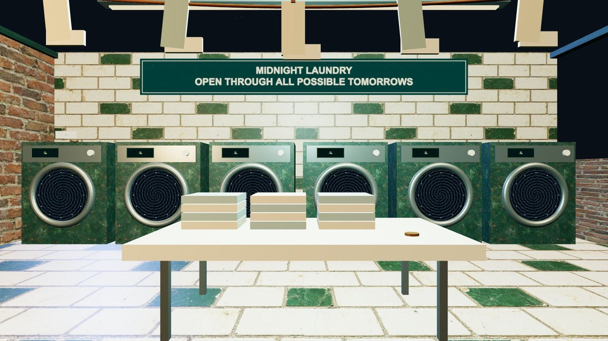
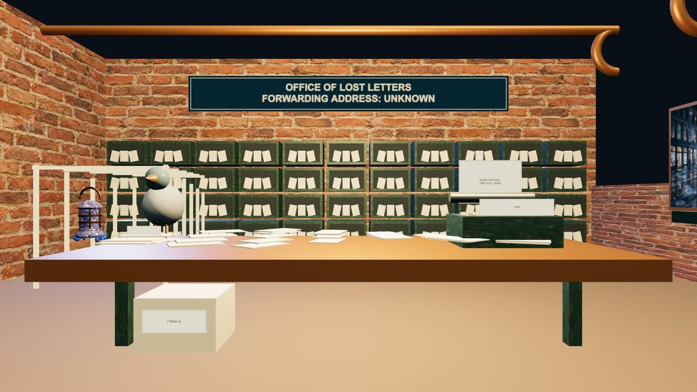
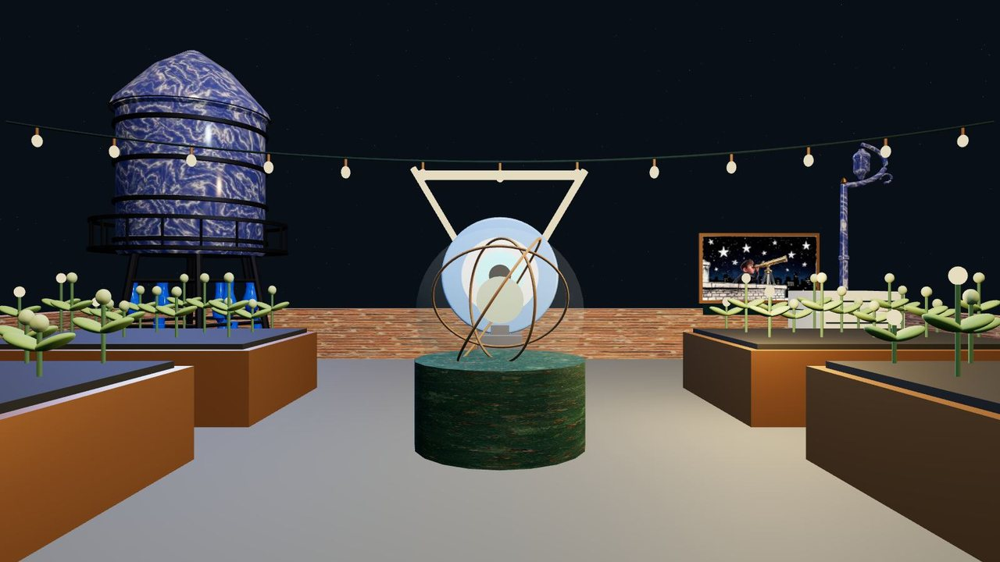

# THE LAST BODEGA IN THE UNIVERSE

**The stars went out: the coffee is still a dollar**

A corner store at the end of the universe, still open.
The shelves are stocked with New Yorkers. The freezer opens onto an archive.
Behind the shop: a laundromat that washes yesterday, a post office for letters that never arrived,
and a roof garden where somebody is growing the next universe.
Forty one secrets. Three brass words. One immortal cat.

**Walk it:** [n3wyorkers.com/bodega](https://n3wyorkers.com/bodega)

| | |
|---|---|
|  |  |
| **Through the freezer: the things we kept** | **The Midnight Laundromat: wash yesterday, keep the change** |
|  |  |
| **The Office of Lost Letters: forwarding address unknown** | **The roof: somebody has to water tomorrow** |

## What is in it

- **The shop**: checkerboard floor, shelves of labels made from the collection, the deli, the payphone, the reverse clock, the cat
- **Cold storage**: through the back freezer, an archive of New Yorkers and a liquid portal
- **The Midnight Laundromat**: washers with drums that never stop turning, lost socks, the impossible fold
- **The Office of Lost Letters**: cubbies, pneumatic tubes, a pigeon postmaster, a corridor that cheats perspective
- **The Garden of the Next Universe**: planters, a water tower, a telescope, an apiary, and a terrarium that waits for three words
- 44 New Yorkers in all, and 41 secrets kept on a receipt

## How it is made

Plain three.js, vendored, no build step. Shelves, machines and the rooms' shells are built in code. Since THE BIG
UPGRADE (2026-11-23) the surfaces are Poly Haven scans (CC0) laid in metres, the rooms have ceilings, upper walls and
mouldings, and the things you walk towards are real models: our own (the N3W BELL payphone, the MLOW AM radio, the mail
cart, the armillary, the brass viewer, rope lines, benches) and Poly Haven CC0 props (light fittings, fans, chairs,
baskets, plants, cans, boxes). Food props are from Kenney's Food Kit (CC0, license alongside).

- `site/look.js`: the look, desktop only. Each room photographs itself into a reflection probe, full anisotropy, screen
  space ambient occlusion and a calm grade; the artworks are masked out of the grade. `?look=0` turns it all off.
- `site/upgrade.js`: the rebuilt rooms. Code objects that a model replaces stay built and hide only once it loads.
  Rooms past the shop load their models on first entry. Firefly plates (`assets/textures/ff_*.webp`, queued in the
  site repo's `_build/museum/FIREFLY_QUEUE.md`) are invisible until their file exists.
- One illusion per room: STILL HERE in the shop, the bending floor in the freezer, WASH YESTERDAY painted down the
  laundromat aisle (stand on the brass marker), the corridor of shrinking doors, the impossible triangle on the roof.

| Path | What it is |
|---|---|
| `site/index.html`, `site/app.js` | the page, the shop and the archive |
| `site/expansion.js` | the laundromat, the letters office, the roof and the ending |
| `site/assets/art.json`, `site/assets/expanded-art.json` | the New Yorkers hang |
| `site/assets/props/`, `site/assets/textures/` | models and materials |
| `site/look.js`, `site/upgrade.js` | the look and the 2026-11-23 rebuild |
| `site/assets/tex/`, `site/assets/fonts/` | scanned materials, the house fonts |
| `checks/` | `node checks/scene-smoke.mjs`, `python3 checks/assets-check.py`, `python3 checks/shots.py OUT SUFFIX` (headless views) |

Run it locally from `site/` with any static server, for example `python3 -m http.server`, then open the address it prints.

WASD or arrows walk, drag to look, Q and R turn, click or E on anything, Rooms jumps between the five places.

Art and code by MLow.
