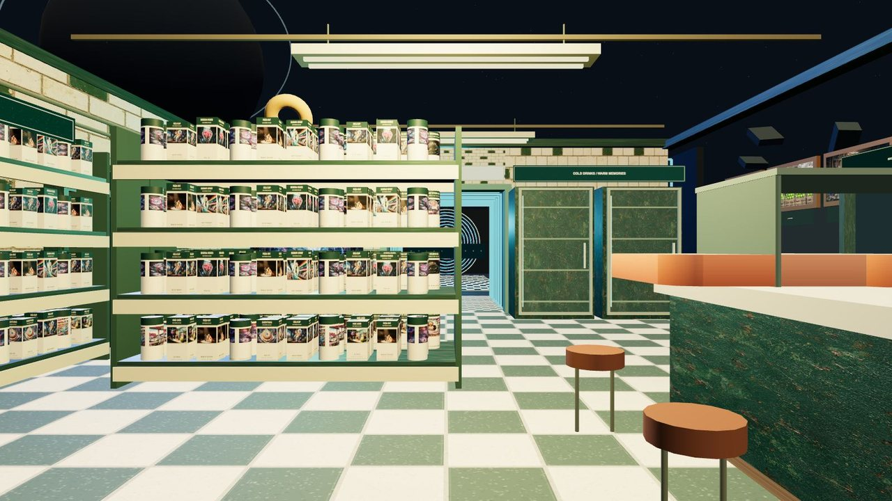
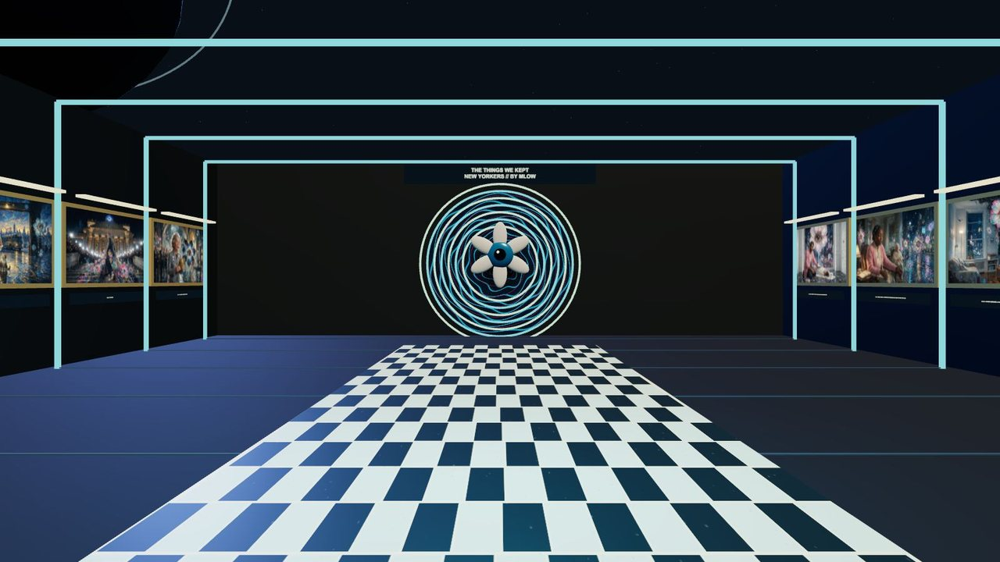
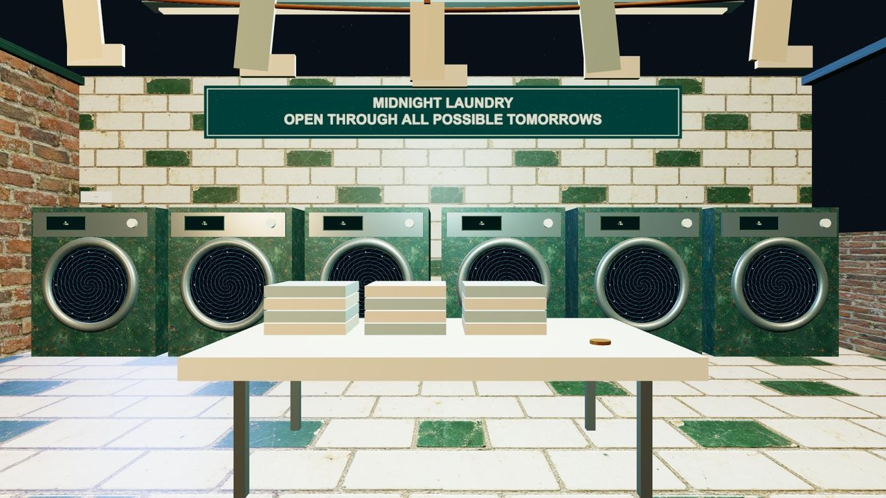
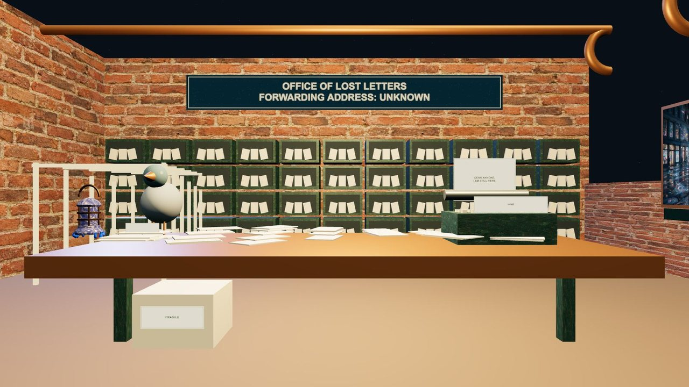
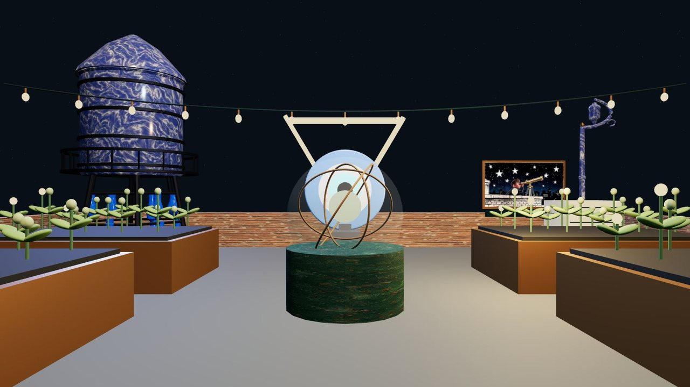

# THE LAST BODEGA IN THE UNIVERSE

**The stars went out: the coffee is still a dollar**

A corner store at the end of the universe, still open.
The shelves are stocked with New Yorkers. The freezer opens onto an archive.
Behind the shop: a laundromat that washes yesterday, a post office for letters that never arrived,
and a roof garden where somebody is growing the next universe.
Forty secrets. Three brass words. One immortal cat.

**Walk it:** [n3wyorkers.com/bodega](https://n3wyorkers.com/bodega)

| | |
|---|---|
|  |  |
| **Through the freezer: the things we kept** | **The Midnight Laundromat: wash yesterday, keep the change** |
|  |  |
| **The Office of Lost Letters: forwarding address unknown** | **The roof: somebody has to water tomorrow** |

## What is in it

- **The shop**: checkerboard floor, shelves of labels made from the collection, the deli, the payphone, the reverse clock, the cat
- **Cold storage**: through the back freezer, an archive of New Yorkers and a liquid portal
- **The Midnight Laundromat**: washers with drums that never stop turning, lost socks, the impossible fold
- **The Office of Lost Letters**: cubbies, pneumatic tubes, a pigeon postmaster, a corridor that cheats perspective
- **The Garden of the Next Universe**: planters, a water tower, a telescope, an apiary, and a terrarium that waits for three words
- 44 New Yorkers in all, and 40 secrets kept on a receipt

## How it is made

Plain three.js, vendored, no build step. Every wall, shelf and machine is built in code; materials are canvas drawn or
generated. Food props are from Kenney's Food Kit (CC0, license alongside); the rest of the models are NEW YORKERS assets.

| Path | What it is |
|---|---|
| `site/index.html`, `site/app.js` | the page, the shop and the archive |
| `site/expansion.js` | the laundromat, the letters office, the roof and the ending |
| `site/assets/art.json`, `site/assets/expanded-art.json` | the New Yorkers hang |
| `site/assets/props/`, `site/assets/textures/` | models and materials |
| `checks/` | `node checks/scene-smoke.mjs`, `python3 checks/assets-check.py` |

Run it locally from `site/` with any static server, for example `python3 -m http.server`, then open the address it prints.

WASD or arrows walk, drag to look, Q and R turn, click or E on anything, Rooms jumps between the five places.

Art and code by MLow.
