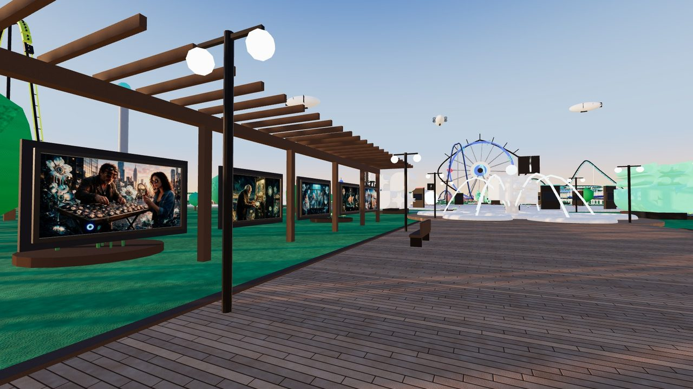
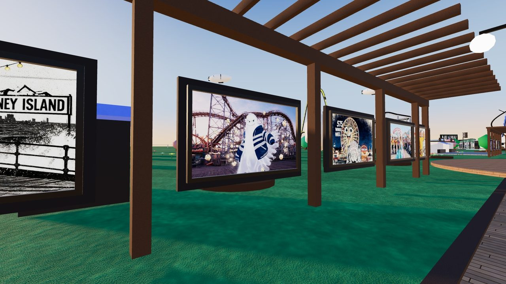
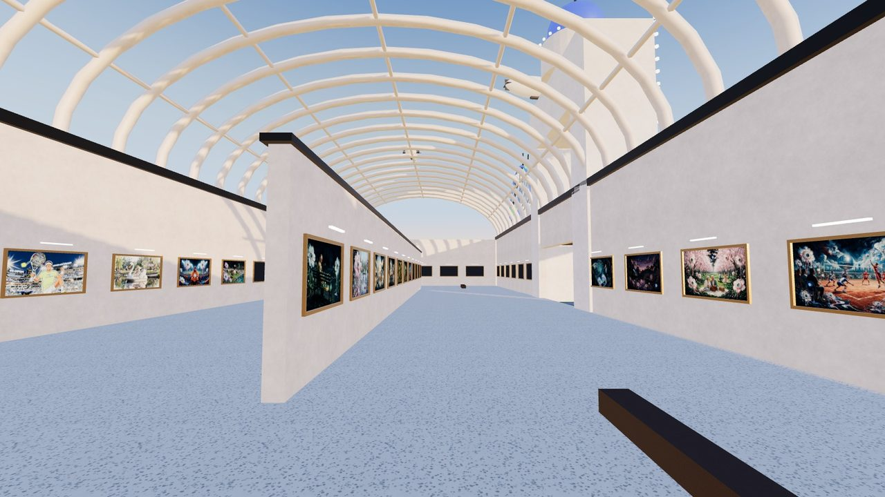
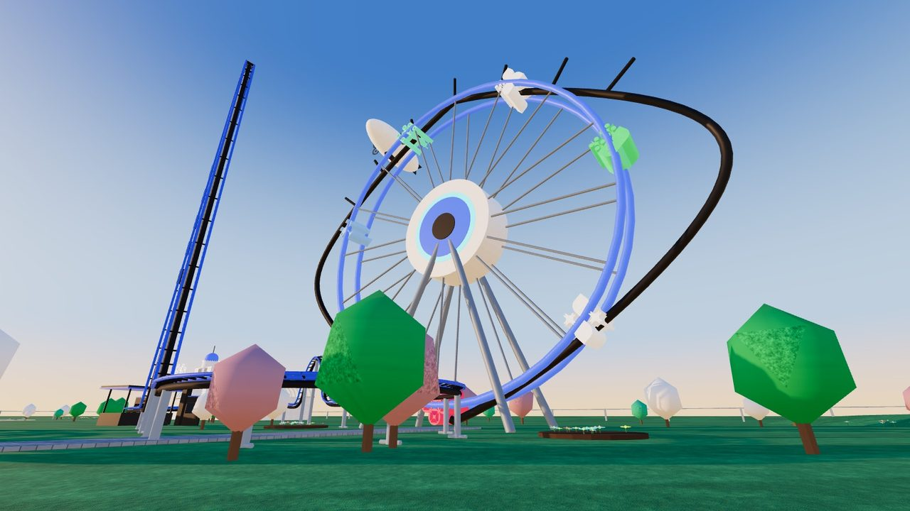
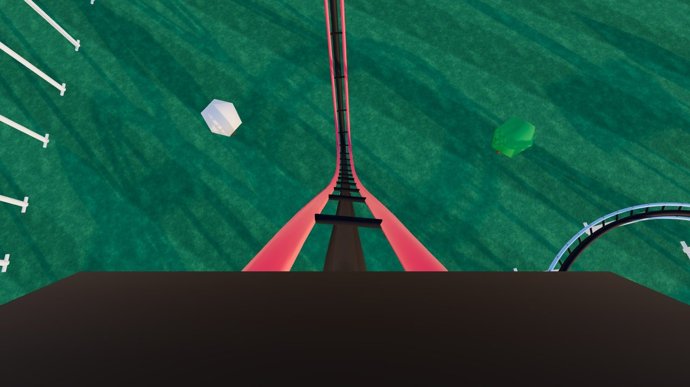
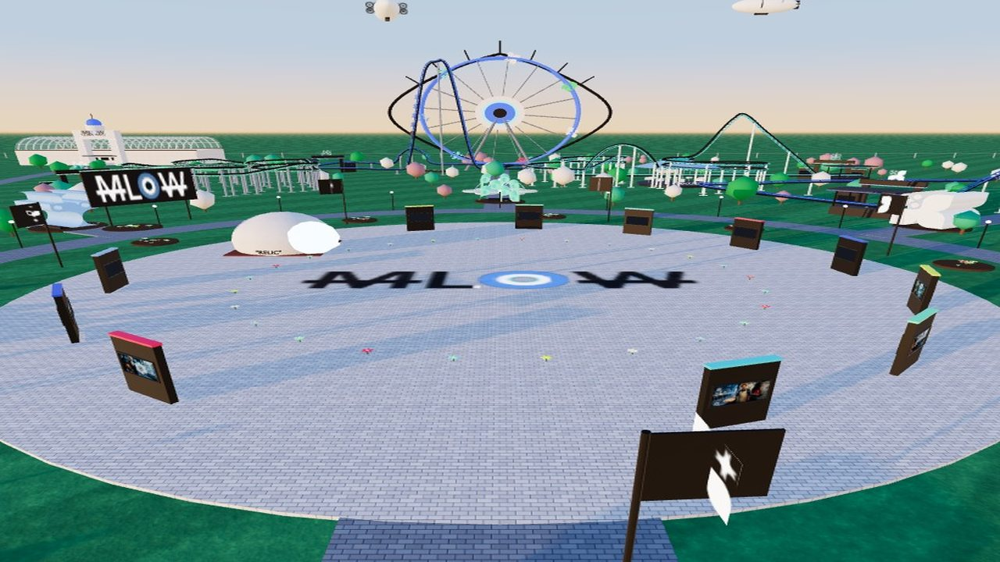
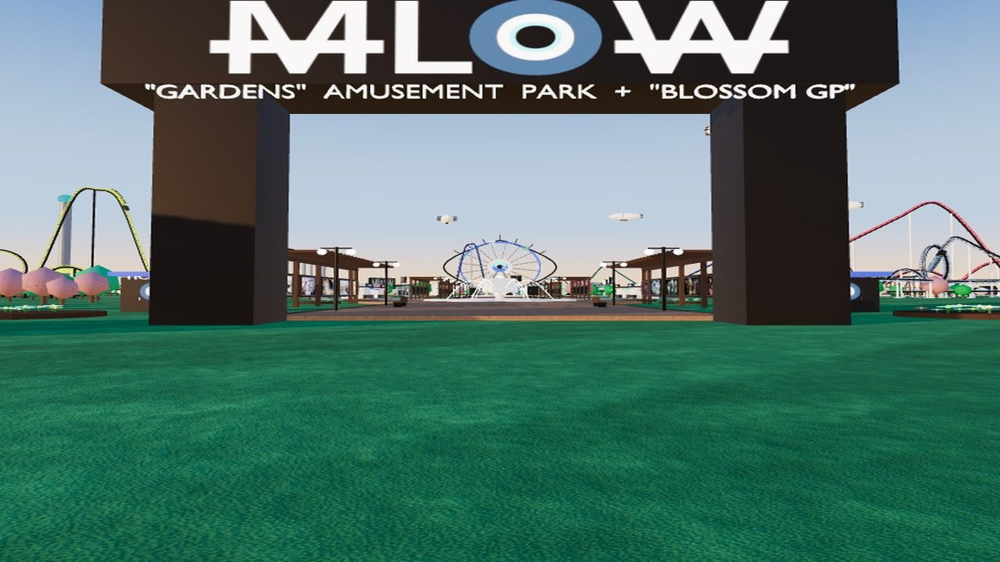
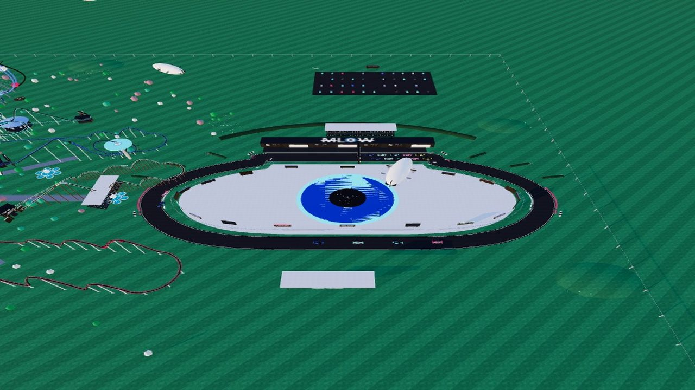
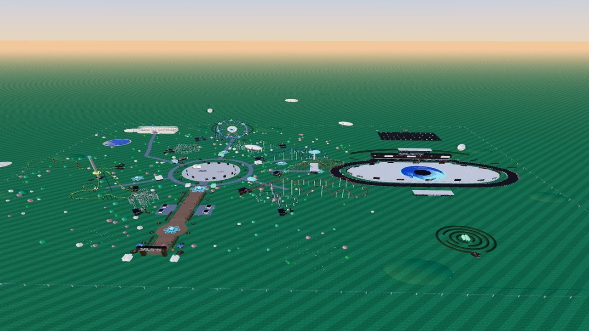

# MLOW GARDENS

**Ride the coasters: stay for Coney Island**

An amusement park built in code, hung with New Yorkers.
Every Coney Island piece lines the boardwalk, in the order it was made.
The parks of New York fill LUNA HALL.
Ride the front car. Watch the race from the back of the pack.
Ten coasters. One eye. Zero tickets

**Walk it:** [n3wyorkers.com/gardens](https://n3wyorkers.com/gardens)

| | |
|---|---|
|  |  |
| **Coney Island, hung where it belongs** | **LUNA HALL: the parks of New York, under glass** |
|  |  |
| **The ferris wheel is the eye** | **The first drop, from the front car** |
|  |  |
| **The logo is the floor** | **Walk in: the first New Yorker you meet is Nathan's Famous** |
|  |  |
| **From the air: the racetrack is the logo** | **Ten coasters. One eye. Zero tickets** |

## What is in it

- **THE BOARDWALK**: a timber deck under a pergola, every Coney Island New Yorker hung in era order from the gate to the plaza
- **LUNA HALL**: a ribbed glass vault for the parks of New York, Prospect Park and Flushing Meadows, named for Luna Park's Million Lights
- **Ten coasters**, each with a station and two poster totems; ride SHOCKWAVE, GARDEN RUN or WILD MOUSE from the front car
- **BLOSSOM GP**: the circuit whose plan is the evil eye; ride along in car 20
- **The Eye Wheel**, a plaza that carries the logo, seven blossom blimps
- 179 New Yorkers in all. Look at one and press E to open its page

## How it is made

The park is generated by Python in Blender (`ARCHITECT/mlow-park-v5`: `build_v5.py`, `v5_ny.py`), exported with its
animation baked, and walked here in three.js. Light is real time: a golden hour sky and a sun whose shadows follow you.
The textures are generated, tileable PBR maps, picked by material name. The art is not baked into the model: 179 empty
frames are filled from `site/assets/art.json`, so the hang is data.

| Path | What it is |
|---|---|
| `site/index.html`, `site/main.js` | the walk |
| `site/assets/gardens.glb` | the park, meshopt and WebP, animation baked |
| `site/assets/scene.json` | viewpoints, the 179 frames, the rides |
| `site/assets/art.json`, `site/assets/art/` | the New Yorkers hang |
| `site/assets/tex/` | the generated textures |
| `site/assets/shots/` | the shots above |

Run it locally from `site/` with any static server, for example `python3 -m http.server`, then open the address it prints.

WASD walk, SHIFT run, mouse to look, E to see a piece, R to ride, F to fly, 1 to 9 to jump.

Art and code by MLow.
